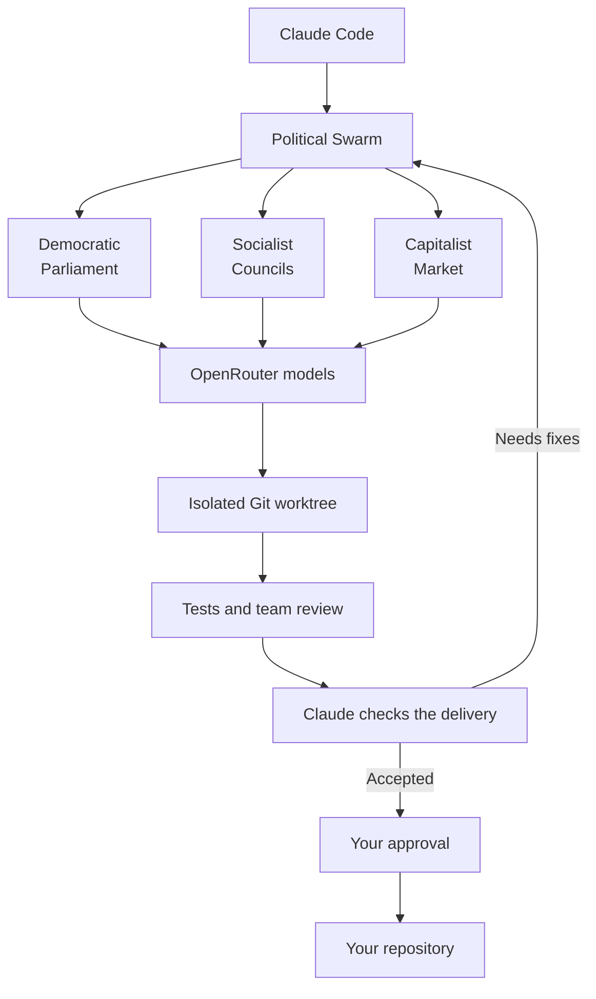

# Political Swarm


**Give your coding team a little politics.** 🗳️

Political Swarm is a Claude Code plugin that sends coding work to OpenRouter models.
Choose how the team works, watch its progress, and review the result before applying it.

| Strategy | How the team works |
| --- | --- |
| **Democratic** | Committees plan, an opposition reviews, and votes settle decisions. |
| **Socialist** | Worker councils share the work and review one another's changes. |
| **Capitalist** | Agents bid for tasks and deliver work through contracts. |

The fun question behind the project: **does the way a team makes decisions change how well it codes?**
It is experimental software, and no strategy is a proven winner.

## How it works



## Quick start

You'll need Git, Node.js 20+, npm, Claude Code, and your own OpenRouter key.

```bash
git clone https://github.com/dgcarr/political-swarm.git
cd political-swarm
cd mcp-server && npm ci && npm run build && cd ..
claude plugin marketplace add "$PWD" --scope local
claude plugin install political-swarm@political-swarm-marketplace
```

### Add your OpenRouter key

Enter it privately in a Bash terminal on Linux or macOS:

```bash
read -r -s -p 'OpenRouter API key: ' OPENROUTER_API_KEY
printf '\n'
export OPENROUTER_API_KEY
claude
unset OPENROUTER_API_KEY
```

Paste your key at the hidden prompt and press Enter. It won't appear on screen or in shell history.
Claude inherits it from this terminal; the final line clears it from the shell when Claude exits.
Use this launch method each time you need the key.

Prefer saving it? Put `OPENROUTER_API_KEY=your-key` in a local `.env` at the **active plugin root**
and restrict it with `chmod 600 .env`. For marketplace installs, that root is
`~/.claude/plugins/cache/political-swarm-marketplace/political-swarm/<version>/`, not your clone.
For `--plugin-dir`, it is the directory you pass. An environment key takes priority over `.env`.

Keep your key out of chat and Git. `.env` is ignored by Git but remains plain text.
If exposed, revoke and replace it in OpenRouter.

### Give the swarm a job

In Claude, run `/mcp` and confirm the `swarm` server connects. Then:

```text
/swarm-setup
/swarm-start "add a function to turn titles into URL slugs" --strategy=socialist
```

No long specification needed. Claude reads the relevant code, adds a few testable requirements
labeled `Inferred:`, and explains important assumptions. It asks a question only when the answer
matters. Without a strategy choice, it uses socialist and tells you.

The target must be a Git repository. Check `config/checks.yaml` for that project's test command;
the default is `npm test`. The default base branch is `main`; use `--base-branch=master` or another
branch name when needed. Review the model budget in `config/budget.yaml` before paid runs.

## Watch, review, apply

The team works in a separate Git worktree. The dashboard opens automatically at
`http://127.0.0.1:8731/`; **Compare runs** shows teams side by side.

```text
/swarm-status
/swarm-diff
/swarm-accept
/swarm-apply
```

When the team finishes, Claude checks the code and evidence. It accepts the result or sends defects
back to the same team. `/swarm-apply` asks for your confirmation before writing to your repository.

| Command | What it does |
| --- | --- |
| `/swarm-setup` | Choose primary and fallback OpenRouter models. |
| `/swarm-start` | Start a coding task. |
| `/swarm-dashboard` | Show the dashboard address. |
| `/swarm-status` | Show progress, cost, and decisions waiting for you. |
| `/swarm-decide` | Answer a pending decision. |
| `/swarm-diff` | Preview the changes. |
| `/swarm-accept` | Have Claude check the finished work. |
| `/swarm-apply` | Apply the reviewed changes with your approval. |
| `/swarm-stop` | Stop a run. |
| `/swarm-resume` | Continue an interrupted run. |
| `/swarm-verify` | Audit the saved run record. |

One short caution: review generated code and actual test results. Worktrees separate Git changes,
but don't sandbox programs; model-written evidence can also be wrong. Budgets can be exceeded by
calls already in progress. See the [security guide](.github/SECURITY.md) for details.

## Updates and local development

Marketplace installation copies the plugin into Claude's cache. After updating and rebuilding your
clone, run `claude plugin update political-swarm`. Check local configuration if the cache version
changes. To load the clone directly for one session:

```bash
claude --plugin-dir "/path/to/political-swarm"
```

Use the same key setup above, replacing `claude` with that command.
Remove the installed plugin with `claude plugin uninstall political-swarm`.

## Try it without an API key

From `mcp-server/`, this tour runs the real engine with a no-op strategy:

```bash
npm run example
```

For development checks:

```bash
npm run build
npm test
npm run smoke:engine
npm run smoke:dashboard-live
```

These checks need no key and make no model calls. CI runs them on pull requests and pushes to `main`.
Other model smoke tests and benchmarks may spend money; see [Contributing](CONTRIBUTING.md).
Graphify is optional.

## Explore further

- [Configuration](docs/Configuration.md): models, budgets, test commands, and dashboard settings.
- [Operations](docs/Operations.md): saved runs, recovery, and audits.
- [How Claude checks deliveries](docs/Orchestrator-Contract.md).
- [Governance philosophies](docs/philosophy/) and [machine-readable constitutions](docs/constitutions/).
- [Benchmark results](docs/Benchmark-Results.md) and [benchmark harness](benchmark/README.md).
- [Contributing](CONTRIBUTING.md) and the [full documentation index](docs/README.md).

Licensed under [Apache 2.0](LICENSE).
