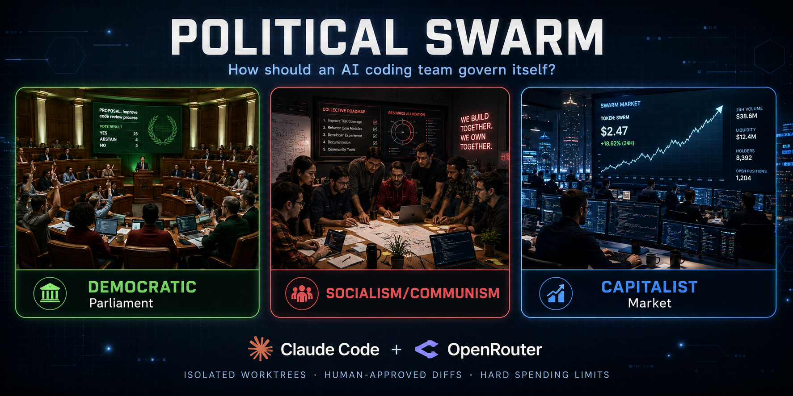
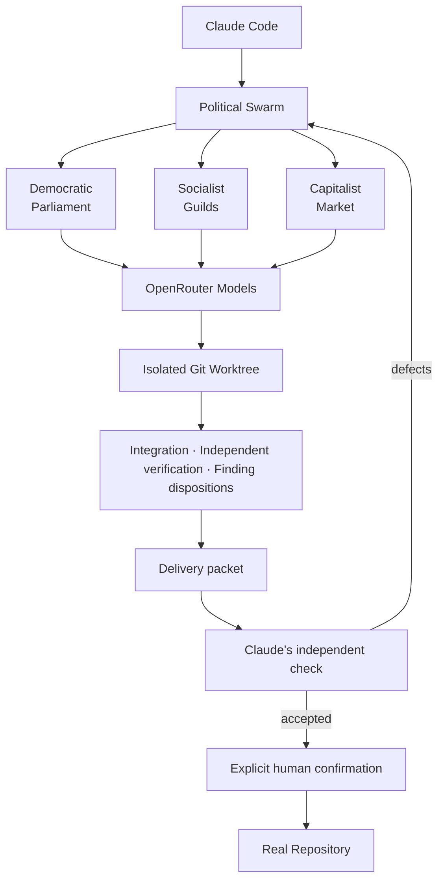

# Political Swarm



**What if your AI coding team governed itself as a democracy, a socialist collective, or a capitalist market?**

Political Swarm is a Claude Code multi-agent coding system that dispatches work to configurable OpenRouter models while coordinating them through radically different governance systems. It is both a practical development tool and a controlled experiment: **does governance structure change how an AI coding team performs?**

- **Democratic** — a Westminster parliament: a Speaker ruling on admissibility, select committees with seats drawn by lot, a shadow cabinet that must be answered, a division of constituency representatives, a revising second chamber, and a constitutional gate no majority can waive.
- **Socialist** — a federated council swarm: worker councils that inspect the repository before the plan is written, a rotating coordinating council whose mandate is bounded and recallable, specialist guilds that advise across councils, mutual aid for a blocked comrade, a worker's right to hand back work it cannot take, and minority reports that survive the decision that overruled them.
- **Capitalist** — agents bid for work using markets, capital accounts, spending decisions, and escrow.

> **Worktree isolated · Human-approved diffs · Hard spending limits**

Claude Code is the external, politically neutral orchestrator: it sequences the run, enforces
resource limits and resolves runtime failures, but never replaces or overrules the doctrine's own
decision procedure. When a swarm finishes it submits a **delivery packet** — evidence, exact check
commands and results, findings with their dispositions, minority reports, limitations and residual
risks — which Claude checks independently and may reject, returning concrete defects to the same
swarm. Internal approval never settles a run on its own.

Swarm agents work in isolated Git worktrees. Ordinary application requires an independently accepted,
completed run and explicit human confirmation through `/swarm-apply`. A separate incomplete-run
salvage path requires disclosure of the incomplete status and fresh human confirmation (see Safety model). Configurable budgets
constrain model expenditure, and a hard ceiling cannot be bypassed by repeated spending approvals.
See [`docs/Orchestrator-Contract.md`](docs/Orchestrator-Contract.md) for how this maps to each
doctrine's own text.

## What Political Swarm does

Give Claude Code a coding goal and select a governance strategy. The bundled MCP server plans and delegates work to OpenRouter models, records decisions and costs, runs verification, and exposes progress through commands and a loopback-only dashboard. The same engine and task can be run under all three strategies to study differences in delegation, review, decisions, cost, and output quality. The benchmark harness additionally runs two control strategies, `managerial` and `single_agent`, which `swarm_start` does not accept.

## Architecture



## Why governance matters

Most agent frameworks focus on models, prompts, and topology. Political Swarm makes the decision system an explicit variable. Democratic opposition may surface risk through adversarial review; guild organization emphasizes specialist ownership and peer review; a market allocates tasks through bids and economic incentives. The project supplies shared infrastructure so those differences can be compared without pretending that one system is already proven superior.

The detailed rationales are in [`docs/philosophy/`](docs/philosophy/).

## Safety model

- Swarm execution takes place in a dedicated branch and isolated Git worktree. The user's normal working tree is not directly modified during a run.
- A run reaches `awaiting_acceptance`, never `completed`, on the swarm's own say-so. `/swarm-accept` performs Claude's independent check — tracing every acceptance criterion to its evidence, reading the complete diff, and weighing unresolved findings — and either completes the run or returns concrete defects to the same swarm.
- `/swarm-apply` is the controlled path that writes generated changes to the real repository. Ordinary application requires an independently accepted, completed run. A separate salvage path permits `terminated_incomplete` with `allowPartialFromIncomplete: true`; the command requires disclosure of the incomplete status and fresh human confirmation. The tool rejects unresolved approvals, unapproved requested tasks, and an empty approved-task selection. Salvage does not make the run an accepted delivery. Both paths show the diff and require explicit human confirmation; the command disables model invocation.
- No doctrine may delete, skip or weaken an existing test to obtain a passing result. The engine detects it before the change is applied and tells a human through a `test_waiver` approval. That floor cannot be lowered by any committee, council or contract, or by the human's answer: approving only sends the task back for another attempt, which is checked again.
- A run that produced no acceptable delivery ends `terminated_incomplete` and is reported as such. Partial work is never presented as accepted.
- Each governance mode also contains approval and escalation mechanisms for risk, disputes, or spending.
- `config/budget.yaml` defines a per-run spending limit, per-task limits on attempts and institutional calls, and a hard ceiling. Socialist council assignments reserve task spending envelopes from the shared run budget according to assessed need; dispatch stops when an envelope is exhausted. A single in-flight model call can exceed its remaining envelope because its final price is known only after it returns. Approving more spending cannot raise expenditure beyond the hard ceiling.
- The dashboard is read-only, loopback-only, and rejects methods other than GET and HEAD, and unrecognized hosts.
- Every run keeps a hash-chained ledger and adopts its doctrine's machine-readable constitution ([`docs/constitutions/`](docs/constitutions/)); a decision must follow a rule the constitution declares. `/swarm-verify` checks the chain, replays governance from the ledger and reconciles spend. `/swarm-resume` continues a run cut off by a restart or crash from its saved state.
- `/swarm-apply` asks for a second, explicit confirmation when the diff touches sensitive paths.
- On Linux, `sandbox: bubblewrap` in `config/checks.yaml` runs every check without network and with the filesystem read-only outside the worktree (default `none`; see [`.github/SECURITY.md`](.github/SECURITY.md)).

Worktree isolation is a Git safety boundary, **not an operating-system sandbox**. Treat generated code and commands as untrusted and inspect them before execution.

**Known MCP trust limitation:** MCP cannot cryptographically distinguish a direct human request from Claude independently deciding to request an operation. Apply enforcement is procedural—Claude Code permissions, command instructions, and human confirmation—not a protocol-level identity guarantee.

## Quick start

Prerequisites are Git, Claude Code, Node.js 20 or later (`engines` in `mcp-server/package.json`; CI pins 20), npm, and an OpenRouter account/key.

```bash
git clone https://github.com/dgcarr/political-swarm.git
cd political-swarm
cp .env.example .env                 # then add OPENROUTER_API_KEY locally
cd mcp-server && npm install && npm run build && cd ..
claude plugin marketplace add "$PWD" --scope local
claude plugin install political-swarm@political-swarm-marketplace
```

Restart Claude Code, run `/mcp`, and confirm the `swarm` server exposes **15 tools**. Then:

```text
/swarm-setup
/swarm-start "add an isEven function with a unit test" --strategy=democratic
/swarm-status
/swarm-diff
/swarm-accept
/swarm-apply
```

The target must be a Git repository. The worktree forks from `main` unless you pass another base
branch (`/swarm-start ... --base-branch=master`, the `baseBranch` argument of `swarm_start`).
`config/checks.yaml` is the check list for **every** target repository, and its default `unit`
category runs `npm test`; for a Python or other non-npm repository, edit it first — see
[`docs/Configuration.md`](docs/Configuration.md).

Everyday prompts do not need a formal specification. `/swarm-start` inspects relevant context,
preserves explicit criteria, and adds a small checkable checklist labeled `Inferred:`. Consequential
defaults are recorded as `Assumption:` constraints and briefly disclosed before starting. Claude asks
only about important unresolved choices, not routine implementation details or checklist approval.
The current repository and established strategy are reused; without a strategy preference it uses
socialist and says so. Inferred criteria become top-level requirements with the same evidence checks.
This preparation is Claude's workflow (also described by the MCP tool); the server does not itself
generate criteria for API clients that pass an empty list. Applying changes still requires confirmation.

### Try it without a key

```bash
cd mcp-server && npm install && npm run example
```

`npm run example` (`mcp-server/src/examples/governanceTour.ts`) is a zero-cost end-to-end tour that
needs no API key or network: the real engine takes a scratch repository through a whole run to
Claude's acceptance with a no-op strategy, a run adopts its constitution, a forged vote tally is
refused before it reaches the ledger, and the verifier catches a ledger edited after the fact. CI
runs it on every pull request.

### Try a doctrine

Run one doctrine for real, either through `/swarm-start` on a scratch repository or with
`npm run smoke:democratic` (also `smoke:socialist`, `smoke:capitalist`) from `mcp-server/`. These
spend real money: recent runs with the configured roster cost about $0.12–0.60 per doctrine run, and
the democratic smoke caps each of its three scenarios at $0.30. Then read the run's `ledger.jsonl`
— the Speaker's rulings, the divisions and abstentions, minority reports, the stage 9 report — and
audit it with `/swarm-verify`, or from a shell with `npm run verify:run -- <runId>` (smoke runs live
under `runs/smoke-<doctrine>/`, so add `--runs-dir ../runs/smoke-democratic`).

## Installation

### Persistent local installation (recommended)

Clone and build as above. Register the repository directory as a local marketplace with `claude plugin marketplace add "/path/to/political-swarm" --scope local`, then install `political-swarm@political-swarm-marketplace`. Restart Claude Code after installation. Use `--scope project` only when you intentionally want to share marketplace registration with a project.

Installing **copies** the repository into `~/.claude/plugins/cache/political-swarm-marketplace/political-swarm/<version>/`, and `${CLAUDE_PLUGIN_ROOT}` points at that copy. The server loads the `.env` in the plugin root (`mcp-server/src/index.ts`: `<plugin root>/.env`, with `SWARM_PLUGIN_ROOT` overriding the root), so the key, `runs/`, `config/` edits and `config/models.local.json` all live in the cache copy, not your clone. After pulling or rebuilding the clone, run `claude plugin update political-swarm` (or reinstall) to pick up the changes. Session-only loading with `--plugin-dir` (below) uses the clone in place and avoids the copy.

### Session-only development

```bash
claude --plugin-dir "/path/to/political-swarm"
```

This loads the plugin only for that session. Update with `claude plugin update political-swarm`; remove it with `claude plugin uninstall political-swarm`.

The registered MCP tools are: `swarm_start`, `swarm_status`, `swarm_get_diff`, `swarm_decide`, `swarm_get_delivery`, `swarm_accept`, `swarm_remediate`, `swarm_apply`, `swarm_stop`, `swarm_resume`, `swarm_verify_run`, `swarm_list_runs`, `swarm_list_models`, `swarm_configure_models`, and `swarm_dashboard`.

## Usage

| Command | Purpose |
| --- | --- |
| `/swarm-setup` | Browse OpenRouter's catalog and persist primary/fallback model choices. |
| `/swarm-start` | Start a task with `democratic`, `socialist`, or `capitalist` governance (the only strategies `swarm_start` accepts). |
| `/swarm-dashboard` | Print the local live-dashboard URL. |
| `/swarm-status` | Show progress, cost, and pending approvals. |
| `/swarm-decide` | Resolve a specific approval, vote, waiver, or spend decision. |
| `/swarm-diff` | Inspect generated changes without applying them. |
| `/swarm-accept` | Perform Claude's independent check of the delivery packet, completing the run or returning concrete defects to the swarm. |
| `/swarm-apply` | Review and explicitly approve changes for the real repository. |
| `/swarm-stop` | Halt a run. |
| `/swarm-resume` | Continue an interrupted run (server restart, crash or signal) from its saved state. |
| `/swarm-verify` | Audit a run's record: ledger hash chain, governance replayed from the ledger, and spend. |

The Political Swarm dashboard defaults to `http://127.0.0.1:8731/` and streams run events, worker activity, budgets, ledger entries, and deterministic governance-specific narration. Compare runs (`?gallery`) compares runs side by side. It is read-only; approvals remain MCP decisions. Set `SWARM_DASHBOARD=0` to disable it, `SWARM_DASHBOARD_PORT` to choose another loopback port, or `SWARM_DASHBOARD_OPEN=0` to prevent it opening in the default browser on MCP server startup. Further optional variables (defaults in `mcp-server/src/dashboard/config.ts`): `SWARM_DASHBOARD_RHETORIC=llm` (opt-in generated narration instead of the deterministic templates), `SWARM_DASHBOARD_WATCH` (tail `runs/` for writes by other processes such as the benchmark harness; on by default), `SWARM_DASHBOARD_NEWSREEL` / `SWARM_DASHBOARD_NEWSREEL_DIR` (newsreel on/off and newsreel library root). See [`docs/Configuration.md`](docs/Configuration.md) for dashboard configuration and [`docs/Operations.md`](docs/Operations.md) for lifecycle and recovery.

## Detailed strategy comparison

| Dimension | Democratic | Socialist | Capitalist |
| --- | --- | --- | --- |
| Organization | Two chambers, a cabinet, a shadow cabinet and a neutral Speaker | Worker councils per unit of production, federated by specialist guild | An internal task exchange, with firms that subcontract where coordination is cheaper than contracting |
| Allocation | Committee planning, with seats filled by election, appointment and lot | Work by capability, resources by assessed need, with a right to return an assignment | Competitive bidding on comparative advantage, so the strongest bidder does not automatically win |
| Review | Opposition brief, government reply, and a division of constituency representatives | Peer review outside the authorship chain, with overruled objections preserved as minority reports | An assessor with no success fee, and a court for the disputes the parties cannot settle |
| Decisions | Risk-scaled vote thresholds, above a constitutional gate no majority can waive | Subsidiarity, delegate recall, and a constitutional gate checked against the run's own record | Priced scarcity, contract shapes chosen to the risk, and a safety floor no commercial party can waive |
| Accountability | Confidence motions, recall, Question Time, and a stage 9 report against what was promised | Delegate recall, an independent diagnosis before any reassignment, and a commons report the run files on itself | Profit and loss against real consumption, insolvency, and a market report the run files on itself |
| Characteristic evidence | Divisions, minority reports and Speaker's rulings | Council reconnaissance, returned assignments, mutual aid, and preserved dissent | Bids and awards with their arithmetic, priced consumption, levies, premiums and refused rescues |

These are mechanisms to investigate, not claims about real-world political systems or guaranteed software outcomes.

## Configuration

| File | Purpose |
| --- | --- |
| `config/models.yaml` | Built-in models, role mapping, pricing, and capability flags. |
| `config/models.local.json` | Gitignored machine-local primary/fallback override written by `/swarm-setup`; reloaded on the next run. |
| `config/model-probe.json` | Cached functional verdicts written by `npm run probe:models`; surfaced by `/swarm-setup`. |
| `config/budget.yaml` | Per-task, per-run, and hard-ceiling limits. |
| `config/strategies.yaml` | Vote thresholds, guilds, bids, escrow, and risk rules. |
| `config/checks.yaml` | Repository check categories and evidence policy used by the engine. |

`ChecksConfig.manualEvidenceAccepted` controls whether the evidence mandate may use a named manual inspection instead of a check category; it defaults to `true`. The benchmark sets it to `false`, so every acceptance criterion must map to an automated check category. Manual inspection cannot satisfy benchmark acceptance.

Run state (per-run records and ledgers) lives under `<plugin root>/runs/`; `SWARM_PLUGIN_ROOT` overrides the plugin root and `SWARM_RUNS_DIR` overrides the runs directory (`SWARM_CONFIG_DIR` likewise overrides `config/`). Never commit `.env` or local model configuration. OpenRouter prices and model availability can change; `/swarm-setup` reads the live catalog. The full reference is [`docs/Configuration.md`](docs/Configuration.md).

### Verifying models actually work

The catalog's own capability flags are advertising, not proof — a provider can declare `response_format` support and still answer a request with HTTP 400 `JSON mode is not enabled for this model`. Two commands cover the two different questions:

| Command | Question it answers | Cost |
| --- | --- | --- |
| `npm run smoke:models` | Checks chat-model catalog metadata and pricing and sends one small Decisions API request per configured decision model. Requires an OpenRouter API key for decision probes. | Free catalog access; small paid decision probes |
| `npm run probe:models` | Does the model actually return valid structured output to the request shape the swarm sends? | ~$2 for the full catalog |

`probe:models` sends the real `WorkerDispatcher` message shape against the planner and implementer schemas and counts only first-attempt successes, since every corrective retry is a cost paid on every run. Results cache to `config/model-probe.json` and are re-probed only when stale (`--max-age-days`, default 30), when catalog metadata moves under a stable id, or — much sooner — when the last failure was a timeout or transport fault, so one congested afternoon cannot blacklist a good model for a month. `--force` re-probes everything; `--max-input-price` bounds the sweep.

`/swarm-setup` reads the cache and will not offer, or will explicitly flag, a model that failed.

## Benchmark / experiment results

The repository includes a reproducible, sequential-by-default harness that gives an identical,
versioned engineering task and equal base budget to all five strategies. It requires Python 3: on first run it creates `benchmark/.venv` from
`benchmark/requirements.txt` (rebuilt when that file changes), and runs the checks, coverage and
oracle under that venv.

Results below are from one controlled, fully logged sweep (2026-10-07/08, label `full-2026-10-07b`,
commit `dfe3a62`): the five strategies run one after another on the same task and the same model roster,
with `--budget-usd 8 --max-wall-clock-min 150 --decision-models pure --full-transcripts` and the
trial-0 arm order. The oracle columns read as two numbers: whether the program runs end to end, and
its score over the checks it could actually judge. A *blocked* check never reached the property it
tests, because the program produced no result to judge (see [`benchmark/README.md`](benchmark/README.md)).
Scores are from the oracle as of the commit that added this table. The sweep's own `metrics.json`
was scored one fix earlier and reports socialist as `runs: no (6 blocked) · functional 6/6`: that
arm writes its CSV to exactly the `--output` path with no `.csv` suffix, which the oracle did not then read.
Capitalist reads 5/12 rather than the 6/12 first published: check 9 now runs TASK.md's literal
`python -m alloydamage calculate examples/304L.yaml`, which crashes on a fresh checkout of that arm
because it writes `results/304L.csv` without creating `results/`.

| Governance | Status | Oracle | Cost | Time | Worker calls | How the run ended |
| --- | --- | --- | ---: | ---: | ---: | --- |
| Democratic | completed | runs: yes · functional 12/12 | $0.48 | 184m | 422 | Accepted under its own rules, with 5 of 7 tasks settled and 2 abandoned and declared as limitations; the sovereign was consulted 10 times |
| Socialist | terminated_incomplete | runs: yes · functional 12/12 | $0.36 | 179m | 268 | Refused its own delivery: a council rejected `nuclear_data.py` for duplicating the weighted-sum logic in `damage.py` |
| Capitalist | terminated_incomplete | runs: yes · functional 5/12 | $0.41 | 165m | 257 | Refused its own delivery: the unit check failed and the contractual assessor withheld acceptance; the oracle finds wrong atomic fractions (Fe 0.254 against 0.714) |
| Managerial | terminated_incomplete | runs: no (10 blocked) · functional 0/2 | $0.24 | 119m | 156 | Rejected all 5 tasks and exhausted graph remediation; no `alloydamage/__main__.py`, so the CLI never ran |
| Single-agent | terminated_incomplete | runs: no (10 blocked) · functional 1/2 | $0.25 | 93m | 137 | Refused its own delivery with the unit check failing; it wrote no CSV output and no test files |

The sweep cost $1.74 in OpenRouter charges, plus the sovereign's Claude calls, which only
democratic made. This is one nondeterministic trial: earlier sweeps showed run-to-run variance
larger than the differences between arms, so read it as a current baseline, not a ranking.

Three engine changes landed after the previous sweeps and before this one. The final delivery
review is no longer charged to individual tasks' institutional-call ceilings. A verifier that passes
a delivery but leaves criteria unlisted is asked once more about those criteria. And oracle failures
no longer reach the swarm with their expected values. Earlier sweeps are therefore not a
like-for-like comparison.

<details>
<summary>History: the 2026-09-22/23 trials and what they found</summary>

These notes analyse the three earlier trials (commit `26d0d1c`), whose table this one replaced.
Those trials predate the implementer repository-reading fix (`3428b9f`), per-trial seeding of
lots (`36aedff`), the 2026-10-07 oracle fixes, and the engine changes above.

**All fifteen runs ended `terminated_incomplete`, and the reason was an engine defect rather than a
property of any doctrine.** It is not that the arms refused their own deliveries: eighteen of the
twenty runs across both sweeps never reached the acceptance barriers at all. One task abandoned at
the attempt ceiling made `allApproved()` false, which ended the run and discarded the five to seven
tasks the doctrine had already approved. Almost always that task was the one writing the tests, and
it could not converge because `toTaskTestResult().passed` means "introduced no regression": a check
that has never passed is classed pre-existing, so the task creating the first test suite could never
register a regression and the engine recorded `testsPassed: true` however broken its tests were. The
decision fell entirely to the reviewer, which read the real output and rejected — 79 of 411 attempts
were rejected while the engine called the tests passing. A further 37 attempts were spent on provider
timeouts, which counted against the same ceiling.

All three are fixed (`7e57ccb`): the test-owning task is judged on the strict whole-suite status,
transport failures no longer consume the rework budget, and an abandoned task is declared as a
limitation in the delivery packet instead of sinking the run. **The table above predates those fixes**
— it measures doctrines through an engine that threw away most of their work, so the spread between
arms is not yet a doctrine comparison.

**Trial 2's low scores are a real shared defect, not an oracle artefact.** Three of the five arms
(democratic, socialist, managerial) interpolate log-linearly — logarithmic in energy, *linear* in
cross-section, `np.interp(log(E_target), log(E_source), sigma_source)` — where the oracle accepts
only linear and log-log (`benchmark/oracle/reference_data.py` `interpolation_candidates`). Log-linear
reproduces every emitted value exactly, including the 533.896772 pure-Fe total against an expected
533.534123 or 531.515430. The other two arms never produced a number: capitalist's entry point
raised, and single-agent emitted no CSV.

Check 6 settles whether the oracle is simply too narrow. It swaps in a synthetic Fe curve of two
points — 1 MeV → 10 barn, 100 MeV → 1000 barn — and requires σ = 10·E at interior points. That curve
is both a straight line and a pure power law, so linear and log-log agree on it exactly; it is a
convention-independent probe. Log-linear returns 159.01 at 2 MeV instead of 20, an 8× error. The
accepted set is not too narrow.

**Revised 2026-10-07: that conclusion was wrong, and log-linear is now accepted.** Check 6 cannot
settle it: a two-point curve spanning two decades is a probe *built* so that only the two accepted
laws are exact, which says nothing about accuracy on the real data. The real test is the
full-resolution IAEA evaluation in `benchmark/raw-source/` (~170k points per element, ENDF law
INT=2). Interpolating the supplied ~400-point CSVs and comparing at 4000 energies over 1 keV-20 MeV,
every convention misses the full evaluation by a similar 1-2% median: lin-lin 1.33%, linear-in-log-E
1.33%, log-log 1.21% for Fe. The laws differ from each other by 0.07-0.4%, much less than that error,
so none is privileged, yet the oracle accepted log-log while rejecting a law closer to lin-lin.
The oracle now accepts all four ENDF laws (INT=2..5), each banded separately, and check 6 accepts
the exact answer of whichever law a submission uses. See `docs/Oracle-Audit-2026-09-24.md`, addendum.

Checks 3 and 4 ("wrong atomic fraction") were never composition errors at all. `_infer_atomic_fractions`
divided the arm's emitted per-element contribution by the *oracle's* interpolated value, so an
interpolation error appeared as a composition error — the ratio of observed to expected fraction was
1.00067972, the log-linear/linear ratio at that energy to seven digits. The oracle now infers those
fractions only at energies the source CSVs tabulate directly, where every convention returns the
listed value, so composition is judged on its own. The t2 scores above rose by two for the three
arms affected, and single-agent's t0 by the same, which is what one defect costing four checks
looked like. One interpolation bug still accounts for checks 1, 2, 6 and 8.

**All three arms wrote the test TASK.md asked for, and all three made it tautological.** Test 6 of
the task says to "verify the interpolation routine against a simple artificial dataset with a known
answer". Each arm built its dataset *from* the convention it had chosen — managerial asserts
σ(√10) = 50 because "linear interpolation in log-space gives exactly 50 barn"; democratic uses
σ = 2·log(E) + 1, commented "linear in log-energy; log-linear interp is exact"; socialist uses
σ = 1, 2, 3 at E = 100, 1000, 10000. A test whose fixture is generated by the implementation's own
convention cannot fail. Single-agent was the only arm to pick a convention-independent fixture
(σ = E², a true power law) — and it never got far enough to be scored on it.

**"Oracle" is the independent 12-check acceptance oracle** (`benchmark/oracle/run_oracle.py`),
run directly against each strategy's final worktree — not the swarm's own self-reported test
results. An audit of those checks on 2026-09-24 fixed two defects — check 5 identified the
unsupported element by substring, which `"calculate"` satisfies, and check 7 accepted a submission
that clamped an out-of-range request instead of refusing it. Both were latent, and re-running the
corrected oracle over all fifteen preserved worktrees reproduced every score unchanged. A third
finding did move scores: checks 3 and 4 could not fail independently of check 1, so the table above
was regenerated after decoupling them. All seven findings of that audit are now closed
([`docs/Oracle-Audit-2026-09-24.md`](docs/Oracle-Audit-2026-09-24.md)), and the checks themselves
are covered by `benchmark/oracle/test_checks.py`, `test_oracle_checks.py` and `test_reference_duplicates.py`, plus an end-to-end suite (`test_oracle_end_to_end.py`) that builds a correct submission and asserts the oracle passes it. Scores still
cluster — ten of the twelve checks invoke the submission, so one broken entry point fails almost
all of them — and a column therefore counts failed checks, not independent defects. The oracle now
says so explicitly in its report, listing the checks it never got to evaluate on their merits. Cost and time are per run; every run in this sweep ended `terminated_incomplete`, so the
"Human Intervention/Retries" column of earlier tables would be 1 throughout and has been dropped.

**Scores are bimodal because the entry point gates ten of the twelve checks.** The oracle invokes
`python -m alloydamage` for every check but one, so an arm whose entry point raises scores near
zero regardless of the physics beneath it. Three of the ten t0/t1 results were decided this way:
democratic's 2/12 was a single unrepaired `ImportError` (`cli.py` imported `load_elements`;
`nuclear_data.py` exported `load_multiple_elements`) on a task killed by repeated 300-second
provider timeouts, and single-agent's 0/12 was a missing `__main__.py` — three files changed in
the whole run. Report the entry-point status alongside the score; the score alone overstates how
much of the work differed.

**Single-owner mandates worked, but they do not settle interfaces.** Democratic's t0 ledger shows
**zero** paths claimed by more than one task, `motions_recommitted` down to 8 (16 in the 2026-09-12
v9 sweep) and no `ownership_handoff` events at all (19 in v9). The `ImportError` above happened
anyway: one task owned `cli.py`, another owned `nuclear_data.py`, neither violated ownership, and
nobody agreed on the names between them.

**Earlier results are not comparable.** Before 2026-09-21 the democratic arm alone received
guidance written for this task (literal CSV headers, provenance tokens, the supported-range detail,
and deterministic checks mirroring part of the hidden oracle); every arm's planner received shared
alloy-specific text; and the four doctrine arms' implementers received alloy-specific reminders that
single-agent did not. All of it was removed; see "What every arm receives" in
[`benchmark/README.md`](benchmark/README.md). The previous sweep (2026-09-12) scored socialist and
capitalist 11/11 and managerial 5/11; part of those scores likely came from the removed text.

**The 2026-09-21 sweep still had unequal treatment**, found and removed on 2026-09-22 — this is the
first sweep run after all six were fixed:
- the capitalist implementer was told to write Node.js on this Python task;
- the democratic and single-agent implementers never saw the goal;
- implementer temperatures differed;
- the sovereign's rejection reasons coached only the arms that escalate;
- the extension allowance was a single first-come pool;
- democratic and socialist read memory left by earlier runs.

"What every arm receives" in [`benchmark/README.md`](benchmark/README.md) lists what every arm gets
now.

**Provider flakiness is an uncontrolled variable, and it costs wall clock rather than money.** Arms
run sequentially, so each samples a different hour of OpenRouter health. Overnight on 2026-09-22 the
implementer models timed out repeatedly at 300s each; capitalist's t1 run spent 184 minutes and was
terminated after its third wall-clock extension was refused, having reached 4 of 6 tasks on $2.66 of
its $8. The `--trial-index` rotation moves each arm to a different slot per trial, which launders
some of this, but three trials mitigate it rather than remove it. No run in this sweep was stopped
by the cost budget.

</details>

**Repeat trials rather than treating one nondeterministic run as conclusive.** See [`benchmark/README.md`](benchmark/README.md)
for the reproducible command and artifacts, [`benchmark/starting-repo/TASK.md`](benchmark/starting-repo/TASK.md)
for the verbatim shared prompt, and [`benchmark/score-rubric.md`](benchmark/score-rubric.md) for
scoring. The task builds a tested Python CLI for Fe-Cr-Ni neutron displacement-damage calculations
using traceable data—a bounded but non-trivial software-engineering task.

**OpenRouter models.** The roster lives in `config/models.yaml`, and the sweep above used the
current one. Every chat role uses `upstage/solar-mini4` (primary) → `openai/gpt-6-luna` (fallback),
and the `decider` role uses `upstage/solar-decide` → `typesafe/jev-1.13` through the Decisions API.
Every arm of a sweep uses the same roster.

The harness records status, wall-clock time, cost, model calls, phase-grouped spend, prompt/completion
tokens, files changed, approvals, task errors, verification runs, the acceptance-time 12-check oracle,
coverage, state, ledger, recovery manifest, and final patch. Democratic, socialist, capitalist, and
managerial gate release; single-agent is a comparison. The `managerial` and `single_agent` strategies run only through `npm run benchmark`, not `swarm_start`. Run from `mcp-server/`:

```bash
npm run benchmark -- --label controlled-run --budget-usd 8 --max-wall-clock-min 150
```

Add `--strategies democratic,socialist` to run a subset (default: all five).

Add `--decision-models off|pure` to choose how bounded governance choices are made (default: `pure`, since 2026-10-05). `pure` consults decision models through OpenRouter’s alpha Decisions API, using the configured `decider` role (`upstage/solar-decide`, with `typesafe/jev-1.13` fallback); unsuccessful or insufficiently decisive results fall back to the ordinary chat procedure. The engine option is `decisionModels: 'off' | 'pure'`. The former `explain` mode is no longer supported. Keep this setting identical across arms in a controlled comparison.

Use `--stop-after plan` or `--stop-after first-task` for an early-stop diagnostic run. Arms run sequentially by default; `--concurrent` runs the selected arms together as a stress test. The live log prints each doctrine’s governing milestone headlines alongside periodic status, cost, and task counts.

Resume an interrupted sweep with `npm run benchmark -- --resume ../benchmark/results/<run-dir>`.

This invokes real models and costs money. Use identical configuration, task commit, budget, environment, and scoring for every strategy; repeat trials rather than treating one nondeterministic run as conclusive.

## Development status

The plugin is version `0.1.1` (the MCP server package is `0.1.0`) and contains the shared engine, five execution strategies (three doctrines available through `swarm_start`, plus the two benchmark-only controls), 15 MCP tools, dashboard,
budget controls, and benchmark harness. It is early-stage experimental software. The only published
release notes are [`docs/releases/v0.1.0.md`](docs/releases/v0.1.0.md) (tag `v0.1.0`); there are no
separate notes for plugin `0.1.1`, and the v0.1.0 notes predate later features such as resume,
verification and constitutions.

## Testing

From `mcp-server/`:

```bash
npm install
npm run build
npm test
npm run smoke:engine
npm run example
npm run smoke:dashboard-live
```

The `PR CI` workflow (`.github/workflows/pr.yml`) runs only on `pull_request`, on Node 20, and covers `npm run build`, `npm test`, the engine and live-dashboard smoke tests (`smoke:engine`, `smoke:dashboard-live`) and the governance tour (`npm run example`). All three run a real engine with the no-op strategy, so they need no API key and no recorded runs. `smoke:dashboard` replays recorded runs from the gitignored `runs/` and `benchmark/results/`, so it fails on a fresh clone and stays a local tool.

`smoke:engine`, `example` and `smoke:dashboard-live` make no OpenRouter calls and incur no model cost. `smoke:mcp`, `smoke:capitalist`, `smoke:democratic`, `smoke:socialist`, `smoke:delivery`, and `smoke:budget` make real OpenRouter calls, and `smoke:models` needs catalog network access and an API key for small paid decision-model probes; `npm run smoke:all` includes the paid ones and should only be run intentionally with a configured key and budget.

## Limitations

- AI output is nondeterministic and can be incorrect or unsafe; human review remains mandatory.
- Worktrees isolate Git changes but do not sandbox filesystem, network, or process access.
- MCP's human-versus-model request limitation is described in the safety model above.
- OpenRouter model availability, behavior, and pricing are external dependencies.
- Verification categories are repository-configured. Task checks are regression-relative except for tasks that own or modify test files, which must also pass the strict required-check suite. Final required checks are strict.
- Benchmark results are recorded (see above) but come from one sweep of three trials, run on an engine since superseded; conclusions require repeated controlled runs and independent scoring.
- The dashboard propaganda library can contain historically offensive material. The repository ships 35 poster images under `assets/propaganda/` (with `credits.json` records); `npm run propaganda:fetch` and `mcp-server/scripts/fetch-from-links.mjs` (which downloads the URLs listed in each tradition's `links.txt`) add more, so curate the library locally.

## Documentation

See the [documentation index](docs/README.md) for operating guides, governance references, and contributor/research material.

- [`docs/Configuration.md`](docs/Configuration.md) — every configuration file and environment variable.
- [`docs/Operations.md`](docs/Operations.md) — run persistence, resume, verification and constitutions.
- [`docs/Adding-A-Governance-Model.md`](docs/Adding-A-Governance-Model.md) — writing a new strategy.
- [`docs/constitutions/`](docs/constitutions/) — the machine-readable constitutions, one JSON file per strategy.
- [`docs/Orchestrator-Contract.md`](docs/Orchestrator-Contract.md) and [`docs/philosophy/`](docs/philosophy/) — Claude's role and each doctrine's text.
- [`benchmark/README.md`](benchmark/README.md) — the benchmark harness and oracle.
- [`.github/SECURITY.md`](.github/SECURITY.md) — threat model and vulnerability reporting.

## Contributing

See [`CONTRIBUTING.md`](CONTRIBUTING.md) for setup, testing, strategy-change guidance, and the contribution workflow. Please use [`.github/SECURITY.md`](.github/SECURITY.md) for responsible vulnerability reporting and never commit API keys.

## Licence

Licensed under the [Apache License 2.0](LICENSE).
